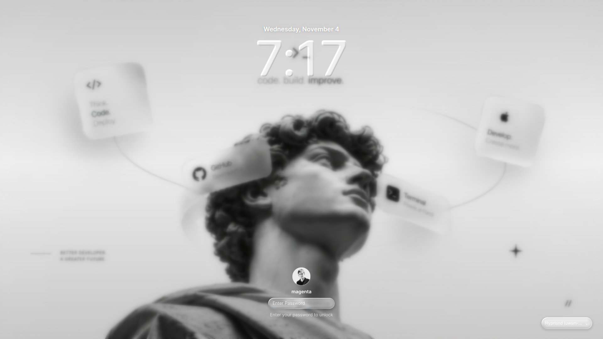

<div align="center">
  <h1>MacSDDM</h1>
  <p><strong>A macOS-inspired Liquid Glass login theme for SDDM.</strong></p>
  <p>
    <a href="https://github.com/MagentaFNS/MacSDDM"></a>
    <a href="https://github.com/sddm/sddm"></a>
    
    <a href="LICENSE"></a>
  </p>
  <p><em>Glass. Motion. A cleaner login screen.</em></p>
</div>

---

## Preview

<p align="center">
  
</p>

<p align="center"><sub>MacSDDM running with the custom monochrome wallpaper and Liquid Glass interface.</sub></p>

## Installation

### Requirements

- Linux with [SDDM](https://github.com/sddm/sddm).
- An SDDM greeter built for **Qt 6** (the theme declares `QtVersion=6`).
- `bash`, `sudo`, and permission to install files under `/usr/share/sddm/themes` and `/etc/sddm.conf.d`.

The repository includes its theme assets, Open Runde font files, and the compiled Liquid Glass shader. You do not need to compile the shader just to install the theme.

### Install from source

```bash
git clone https://github.com/MagentaFNS/MacSDDM.git
cd MacSDDM
chmod +x install.sh
./install.sh
```

The installer opens an interactive menu. Choose **2 — Install and activate** to install MacSDDM and set it as the current SDDM theme.

<p align="center">
  
</p>

<p align="center"><sub>Installing MacSDDM with the included <code>./install.sh</code> script.</sub></p>

### Installer commands

You can also run an action directly, without opening the menu:

| Command | Action |
| --- | --- |
| `./install.sh --preview` | Preview the theme without installing it. |
| `./install.sh --install` | Install MacSDDM and activate it. |
| `./install.sh --install-only` | Install the files without changing the active theme. |
| `./install.sh --restore` | Restore the theme and configuration saved by the previous installation. |
| `./install.sh --uninstall` | Remove MacSDDM, restoring the previous state when a backup is available. |
| `./install.sh --avatar /path/to/avatar.png` | Set a PNG avatar and install/activate the theme. |
| `./install.sh --wallpaper /path/to/wallpaper.jpg` | Set a JPG wallpaper and install/activate the theme. |

Run the installer as your regular user; it requests `sudo` when it needs administrative permissions. Avoid launching it with `sudo`, because its backup directory is stored in your user's home directory.

### Preview manually

The installer's preview option automatically looks for `sddm-greeter-qt6` first, then `sddm-greeter`. You can also launch the Qt 6 preview yourself from the repository directory:

```bash
sddm-greeter-qt6 --test-mode --theme "$PWD"
```

> **Note:** Restarting the SDDM service ends the current graphical session and returns you to the login screen. Save your work before restarting it.

## Features

- **Liquid Glass components** — translucent glass surfaces with refraction, edge/rim and shadow controls, powered by a Qt Quick shader.
- **Wallpaper-aware background** — the wallpaper stays sharp while idle and transitions to a subtle blur during interaction.
- **Smooth entrance motion** — the greeter elements fade and slide into place when the screen appears.
- **Animated password entry** — custom animated password dots, a glass password pill, and a submit control that transitions to a loading spinner while authentication is in progress.
- **Login feedback** — incorrect credentials trigger an error message and a short password-field shake.
- **User selection** — choose an available account, with a username input fallback when the user model is empty.
- **Session selection** — choose an available desktop session from the bottom-right selector.
- **Power controls** — shutdown and reboot controls are shown when SDDM reports that the actions are available.
- **Responsive layout** — interface dimensions scale with the screen height.
- **Simple visual configuration** — set the wallpaper, avatar, font, date format, and time format in `theme.conf`.

## Configuration

The main visual settings are in `theme.conf`:

```ini
[General]
background="assets/wallpaper.jpg"
avatar="assets/avatar.png"
font="Open Runde"
dateFormat="dddd, MMMM d"
timeFormat="hh:mm"
```

| Setting | Description |
| --- | --- |
| `background` | Path to the wallpaper, relative to the theme directory. |
| `avatar` | Path to the account avatar image, relative to the theme directory. |
| `font` | Font family used by the theme. |
| `dateFormat` | Qt date-format string used above the clock. |
| `timeFormat` | Qt time-format string used by the clock. |

The default assets are stored in `assets/`. Keep replacement files at the configured paths, or update `theme.conf` to point to your own assets.

## Backups and recovery

Before replacing an installed theme, `install.sh` saves the previous theme directory and the installer's SDDM configuration (when present) under:

```text
~/.local/share/macsddm/backups/
```

To restore the previous state saved by the most recent installation, run:

```bash
./install.sh --restore
```

The installer also keeps the path to that backup in `~/.local/share/macsddm/last-backup`.

## Project structure

```text
MacSDDM/
├── assets/
│   ├── avatar.png
│   ├── wallpaper.jpg
│   ├── fonts/
│   │   ├── OpenRunde-Regular.otf
│   │   └── OpenRunde-Semibold.otf
│   └── photo/
│       ├── image.png
│       └── image copy.png
├── shaders/
│   └── liquidglass.frag.qsb
├── GlassPill.qml
├── Main.qml
├── metadata.desktop
├── theme.conf
├── install.sh
├── LICENSE
└── README.md
```

## Uninstall

Run the following from the repository directory:

```bash
./install.sh --uninstall
```

When a previous-install backup is available, the installer restores it. Otherwise, it removes the MacSDDM theme directory and the configuration file managed by this installer.

## Credits

- [SDDM](https://github.com/sddm/sddm) — display manager and greeter framework.
- [Qt Quick](https://doc.qt.io/qt-6/qtquick-index.html) — QML UI and animation framework.

MacSDDM is an independent community project inspired by the visual language of macOS. It is not affiliated with or endorsed by Apple Inc.

## License

MacSDDM is released under the [MIT License](LICENSE).

---

<p align="center">
  Made with care by <a href="https://github.com/MagentaFNS">MagentaFNS</a>.
</p>
